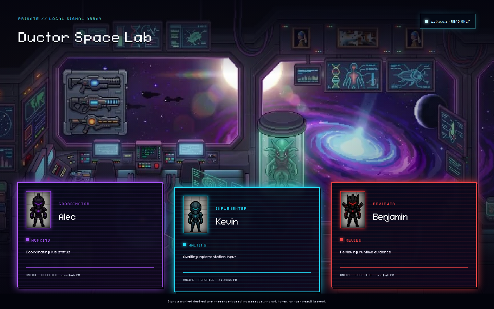

# Ductor Space Lab

_Bao's private live command deck for Alec (planner/architect, purple), Kevin (builder,
cyan), and Benjamin (independent QA, red)._



Ductor Space Lab turns the Alec-Kevin-Benjamin workflow into a focused pixel-art status
board. It shows who is active, what stage each role is in, and how fresh that signal is
without exposing the conversations behind the work.

## The crew

| Agent        | Station | Responsibility                  |
| ------------ | ------- | ------------------------------- |
| **Alec**     | Purple  | Planner and system architect    |
| **Kevin**    | Cyan    | Builder and implementer         |
| **Benjamin** | Red     | Independent QA and release gate |

## Live status, with provenance

- **Local:** the loopback-only command deck reads `.ductor-space-lab/status.json` on every
  snapshot, so status changes appear without a restart.
- **Cloud:** an opt-in publisher checks locally every five seconds, sends changes
  immediately, and sends an unchanged keepalive no more than once every 30 minutes.
- **Provenance:** every card distinguishes an operator/agent report from a local fallback,
  a stale local report, a stale cloud heartbeat, or an unavailable cloud source.
- **Staleness:** a local report older than 45 minutes becomes derived offline status. If
  the cloud heartbeat is older than 45 minutes, all three roles fail closed to offline.

## Privacy boundary

The published status contract is intentionally narrow: agent name, online/offline presence,
state, an optional sanitized task label, timestamps, whether the value was derived, and
its provenance. It does **not** publish prompts, messages, results, file paths, tokens,
environment contents, credentials, or arbitrary provider metadata.

The local deck binds to `127.0.0.1`. The hosted view is a protected, non-production Vercel
preview backed by private storage; heartbeat writes require signed authentication. This
repository and its preview are private operational surfaces, not public dashboards, so no
public homepage is advertised.

## Local quick start

Requires Node.js 20 or newer.

```bash
npm ci
npm run build
npm run ductor:status -- reset
npm run ductor:status -- set Alec working --task "Planning the next move"
npm run ductor:status -- set Kevin working --task "Building the current slice"
npm run ductor:status -- set Benjamin review --task "Running independent QA"
npm run ductor:lab
```

Open the local URL printed by the CLI. Update any card with
`npm run ductor:status -- set <role> <state> --task "<label>"`; supported states are
`idle`, `working`, `waiting`, `review`, `blocked`, and `offline`.

Cloud publishing is optional and requires the approved protected-preview secrets in a
private repo-local config file:

```bash
npm run ductor:publish -- --config .ductor-space-lab/cloud.env
```

## License and upstream

The existing [MIT License](LICENSE) is preserved. This private project is derived from
[pixel-agents-hq/pixel-agents](https://github.com/pixel-agents-hq/pixel-agents); its
upstream history and authorship remain intact.
